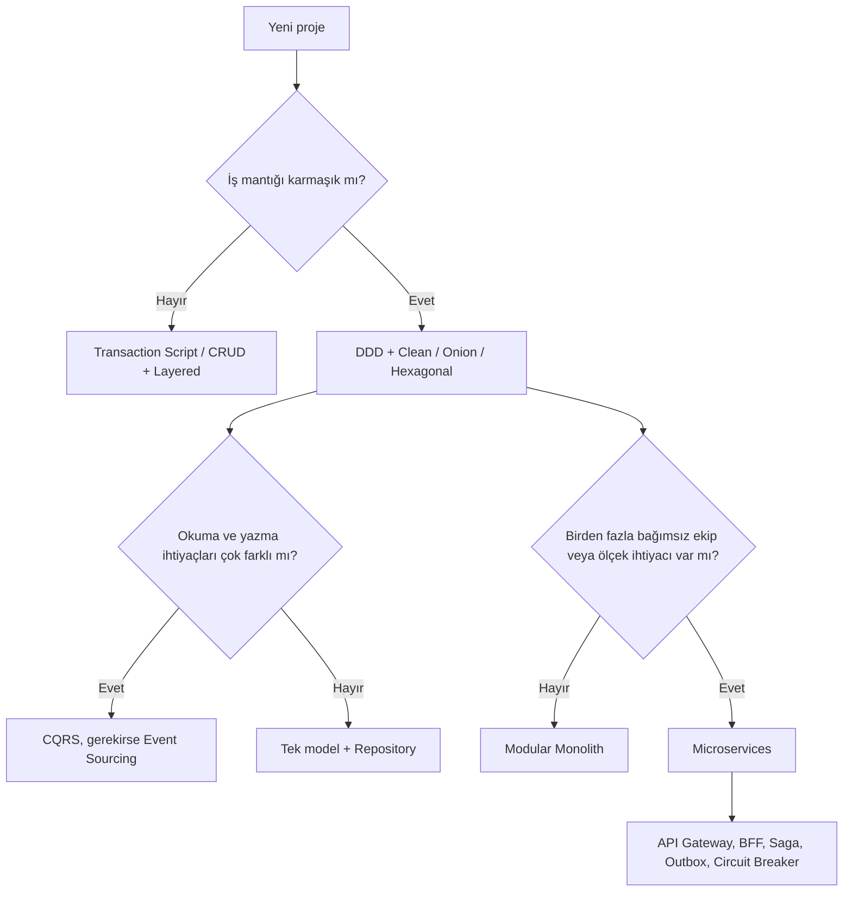

# Karşılaştırma ve karar

## Desenler birbirini nasıl tamamlar

```
                 DDD (iş modeli)
                       |
 Clean / Onion / Hexagonal  <-- iç yapı -->  CQRS + Mediator + Repository + UoW
                       |
         Modular Monolith  -->  Microservices
                                     |
          API Gateway, BFF, Saga, Outbox, Circuit Breaker, Sidecar
```

## UI desenleri

| Desen        | Bağlama biçimi         | Test kolaylığı | Tipik kullanım             |
| ------------ | ---------------------- | -------------- | -------------------------- |
| MVC          | Controller yönlendirir | Orta           | Sunucu taraflı web         |
| MVP          | Presenter yönetir      | Yüksek         | Masaüstü, eski mobil       |
| MVVM         | Veri bağlama           | Yüksek         | Vue, Angular, WPF, SwiftUI |
| MVI          | Tek yönlü durum        | Yüksek         | Reaktif arayüzler          |
| Flux / Redux | Global store           | Yüksek         | React uygulamaları         |

## İç mimari stilleri

| Stil           | Bağımlılık yönü         | Karmaşıklık | Ne zaman                         |
| -------------- | ----------------------- | ----------- | -------------------------------- |
| Layered        | Yukarıdan aşağıya       | Düşük       | Basit ve orta projeler           |
| Onion          | Merkeze doğru           | Orta        | Domain odaklı uygulamalar        |
| Hexagonal      | Port ve adapter ile içe | Orta        | Çok sayıda dış entegrasyon       |
| Clean          | Merkeze doğru           | Orta-Yüksek | Uzun ömürlü kurumsal uygulamalar |
| Vertical Slice | Özellik bazlı           | Düşük-Orta  | CQRS tabanlı API'ler             |

## Dağıtım mimarisi seçimi

| Durum                                  | Öneri                |
| -------------------------------------- | -------------------- |
| Yeni proje, küçük ekip                 | Monolith             |
| Büyüyen ekip, net modüller             | Modular Monolith     |
| Bağımsız ölçek, çok ekip, olgun DevOps | Microservices        |
| Olay tetiklemeli, düzensiz yük         | Serverless           |
| Bileşenler arası asenkron iletişim     | EDA                  |
| Eski sistemi modernize etme            | Strangler Fig ve ACL |

## Karar akış şeması



## Sık yapılan hatalar

<table data-search="false"><thead><tr><th>Hata</th><th>Açıklama</th></tr></thead><tbody><tr><td>Moda odaklı seçim</td><td>Gerek yokken popüler deseni kullanmak</td></tr><tr><td>Dağıtık monolit</td><td>Mikroservisler birbirine sıkı bağlı ve birlikte dağıtılıyor</td></tr><tr><td>Anemic Domain Model</td><td>Entity'ler yalnızca veri taşıyor, tüm mantık servislerde</td></tr><tr><td>Şişman controller</td><td>İş mantığı controller'a doldurulmuş</td></tr><tr><td>Her yerde generic repository</td><td>ORM üstüne anlamsız sarmalama</td></tr><tr><td>Paylaşılan veritabanı</td><td>Birden fazla servis aynı tablolara yazıyor</td></tr><tr><td>Aşırı soyutlama</td><td>İhtiyaçtan fazla katman ve arayüz</td></tr></tbody></table>

## Kontrol listesi

* [ ] Önce problemi tanımladım mı, yoksa deseni mi aradım?
* [ ] Bağımlılık yönü net mi?
* [ ] Sınırlar (modül veya bounded context) iş diline göre mi çizildi?
* [ ] Dağıtık sistemse idempotency, retry, timeout ve circuit breaker düşünüldü mü?
* [ ] Gözlemlenebilirlik (log, metrik, trace) planlandı mı?
* [ ] Karar, bir ADR (Architecture Decision Record) ile belgelendi mi?
